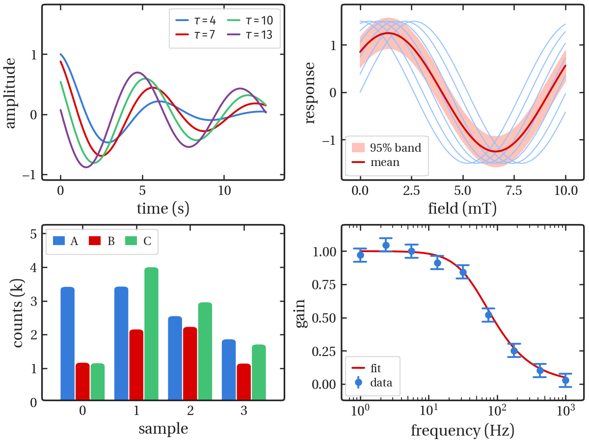
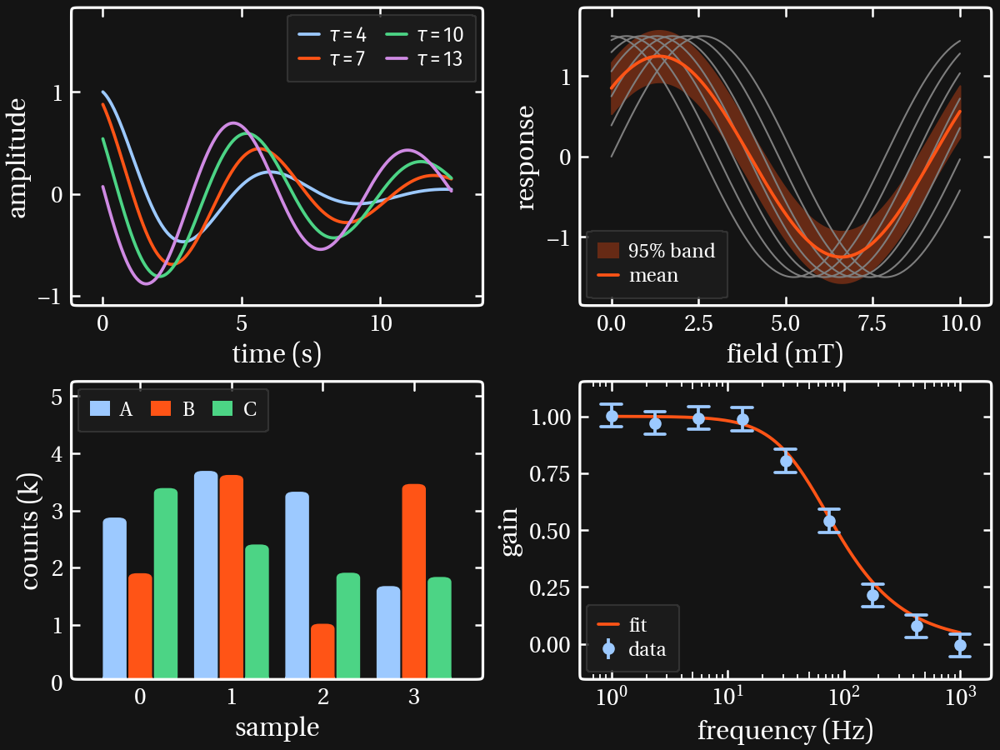
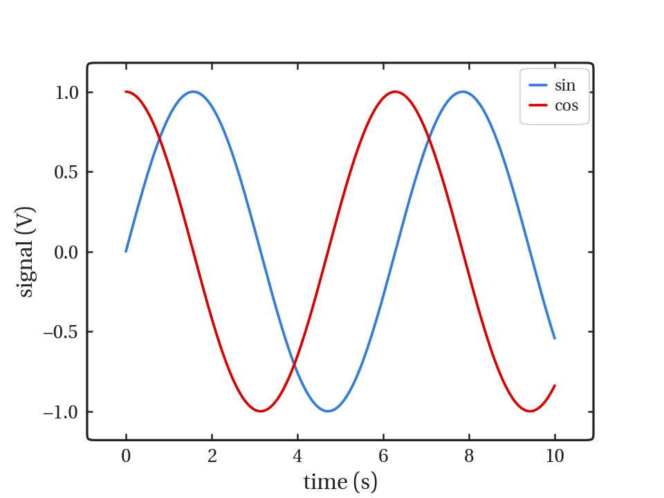
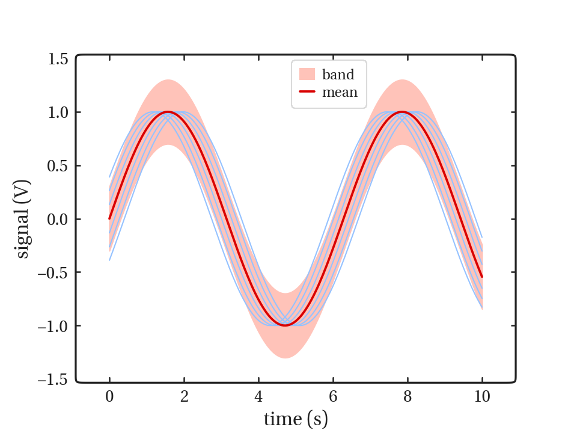
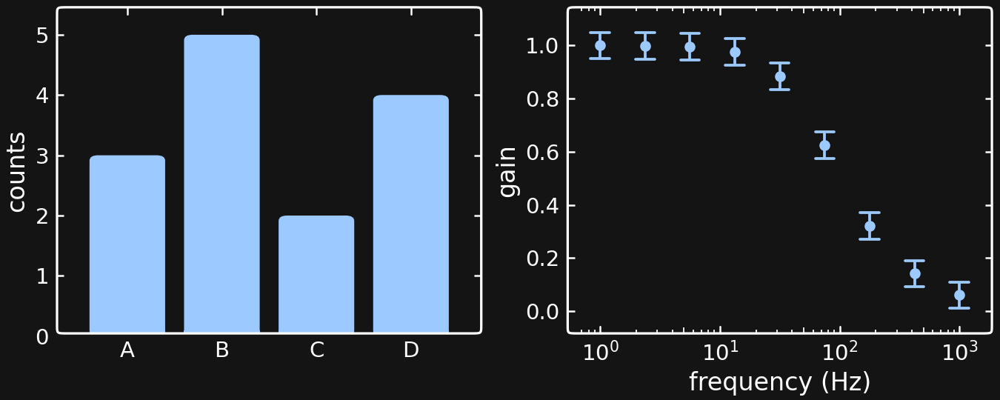
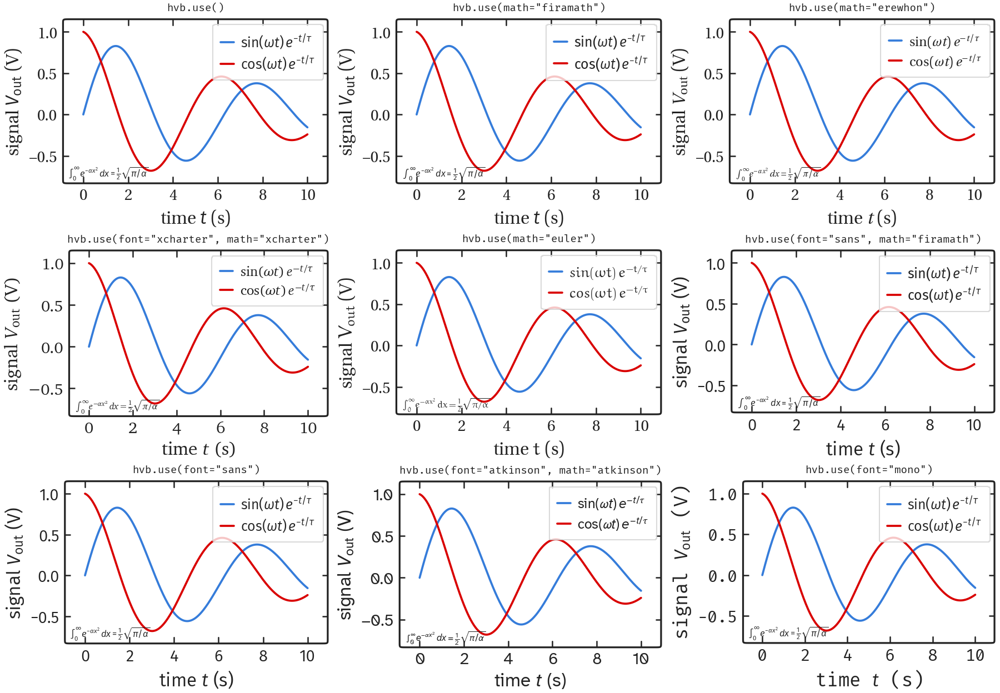

# hvb

hvb is a matplotlib style suited to my tastes. It consists of a style file, `hvb.mplstyle`, and helper
functions that replace the square axes frame with a superellipse, round the
corners of bars, histograms, box plots, violin plots, and error bars, and provide a set of
categorical color palettes. Basically, make soft, easy on the eyes plots, that are
still professional looking.

<p>
  
  
</p>

The same four panels drawn with `hvb.use(scale=0.6)` (left) and `hvb.use(scale=0.6, dark=True)`
(right). They show a line plot with a legend, a primary line over `muted` context lines with a
`fill` confidence band, grouped bars, and error bars with a fit on a logarithmic axis.

## Installation

With pip:

```
pip install git+https://github.com/AlexanderBeach/hvb
```

With uv, either into the active environment or as a dependency of a uv project:

```
uv pip install git+https://github.com/AlexanderBeach/hvb
uv add git+https://github.com/AlexanderBeach/hvb
```

## Usage

```python
import numpy as np
import matplotlib.pyplot as plt
import hvb

hvb.use(scale=0.6)

x = np.linspace(0, 10, 200)
fig, ax = plt.subplots()
ax.plot(x, np.sin(x), label="sin")
ax.plot(x, np.cos(x), label="cos")
ax.set_xlabel("time (s)")
ax.set_ylabel("signal (V)")
ax.legend()
fig.savefig("figure.pdf")
```



`hvb.use()` applies the style globally. The squircle frame, the legend frame, and the tick
placement are applied when a figure is saved with `fig.savefig` or shown with `plt.show`, not
when it is drawn, so a figure rendered with `fig.canvas.draw()` alone will still have the
default matplotlib frame.

On a logarithmic axis, the minor ticks at half the base in each decade (5, 50, 500, ... for
base 10, 8, 128, ... for base 16) are drawn longer than the other minor ticks; with `scale`
set, they are 5.8 pt, between the 4.5 pt minor and 6.7 pt decade ticks (8.65 pt between 6.7
and 10 pt without it). `hvb.MID_DECADE_TICK` sets where they fall, from 0 (the minor tick
length) to 1 (the major).

A legend left at matplotlib's default `loc="best"` is moved off the plot when the figure is
saved or shown. matplotlib's `"best"` tries only nine fixed spots and counts data points rather
than the area they cover, so its choice can still sit on a fill, a dense line or a label. hvb
starts from that spot and moves the legend to the nearest spot inside the frame that is covered
less, counting everything in the axes but the background and the gridlines, including lines,
fills, scatter points, text, annotations, inset axes, the frame, the ticks, the tick and axis
labels, and the artists of any axes laid over it, such as a twin. If no spot is clear enough,
one end of the x- or y-range is extended just enough to make one, by at most 60% of the axes
width or height. Of the top, bottom, right and left, the end that needs the least room is
extended, the earlier in that order on a tie. A range set with `ax.set_xlim` or `ax.set_ylim`,
or shared with another axes, is never changed, and a legend given an explicit `loc`, or added
to the figure rather than an axes, is left where it was put.

The arguments to `hvb.use()` are:

- `scale`: multiplies the frame, tick, grid, and data line widths, for figures smaller than
  the default size. Font sizes are left unchanged unless `text` is also set.
- `text`: `True` scales the font sizes by `scale` as well. A number scales the font sizes by
  that factor instead.
- `dark`: `True` switches to a `#141414` background with white text and frame, and the
  `dark-background` palette. A color string sets a different background color.
- `palette`: the name of the palette used for the color cycle (see below).
- `font`: the text font. One of the bundled names `"serif"` (hvb Serif, the default),
  `"xcharter"`, `"sans"` (FiraGO Book), `"atkinson"` (Atkinson Hyperlegible Next) or `"mono"`
  (Fira Code), the name of an installed font, or the path to a font file. Math keeps its own
  font.
- `math`: the math font. One of the bundled setups `"fira"` (the default), `"firamath"`,
  `"erewhon"`, `"xcharter"`, `"euler"` or `"atkinson"`, described under Fonts, or the name of
  an installed font family, whose regular, italic and bold faces are used.
- `linewidth`: the data line width in points, overriding the width set by `scale`.
- `grid`: `False` by default. Calling `ax.grid(True)` on an individual axes still turns the
  grid on for that axes.
- `exponent`: the superellipse exponent n of the frame, 120 by default. A higher exponent gives
  smaller corners. The legend frame uses the same absolute corner radius as the axes frame,
  whatever the size of the legend.
- `flat_face_ticks`: `True` by default, which hides any tick that would land on a rounded
  corner of the frame rather than on a straight edge.
- `legend_strictness`: how far legends are moved off the plot, 0 or more. A legend may be
  covered by `1 - legend_strictness` times as much of the plot as at matplotlib's spot, so 0
  keeps matplotlib's `loc="best"`, 0.5 halves the overlap it has there, and 1, the default,
  lets nothing touch the legend or the small clearance kept around it. The clearance grows with
  the strictness, and values in between move the legend, or extend a range, by amounts in
  between. Above 1 nothing may touch the legend either, and the clearance keeps growing, so 2
  keeps twice the clearance of 1. If no spot is that clear, the legend goes to the least covered
  one.
- `legend_zones`: where legends may go, one name or a list of names, `"anywhere"` (no limit) by
  default. The axes are split into a 3 by 3 grid and a legend is in the cell its center is in.
  The names are `"top-left"`, `"top-right"`, `"bottom-left"`, `"bottom-right"`, `"top"`,
  `"bottom"`, `"left"`, `"right"`, `"center"`, `"corners"` (the four corners), `"sides"` (top,
  bottom, left and right together) and `"anywhere"`. An edge name is the whole edge, corners
  included, so `"top"` is the top row. A list allows any of its zones, so
  `["corners", "bottom"]` allows the four corners and the bottom row. The legend goes to the
  nearest allowed spot that is clear enough, or the least covered allowed spot, and a range is
  extended only if that opens a clear spot in the zones. A legend too large for any spot in the
  zones goes to the closest one. With a zone set, `legend_strictness=0` still moves the legend
  into the zone, to a spot covered no more than matplotlib's.
- `legend_room`: the largest share of the axes width or height a range may be extended by to
  clear a spot for a legend, 0.6 by default. 0 keeps every range as matplotlib sets it.
- `auto`: `False` sets the rcParams only, without the squircle frame, the legend styling, the
  rounded bars and error bars, or the longer mid-decade ticks, and switches these off if an
  earlier `hvb.use()` turned them on.

Polar and 3D axes are left with the default matplotlib frame.

## Examples

A primary line drawn over `muted` context lines with a `fill` band, using the palettes directly:

```python
import numpy as np
import matplotlib.pyplot as plt
import hvb

hvb.use(scale=0.6)
muted = hvb.get_hvb_palette("muted")
fill = hvb.get_hvb_palette("fill")
default = hvb.get_hvb_palette("default")

x = np.linspace(0, 10, 200)
fig, ax = plt.subplots()
for phase in np.linspace(-0.4, 0.4, 7):
    ax.plot(x, np.sin(x + phase), color=muted[0], linewidth=1)
ax.fill_between(x, np.sin(x) - 0.3, np.sin(x) + 0.3, color=fill[1], label="band")
ax.plot(x, np.sin(x), color=default[1], label="mean")
ax.set_xlabel("time (s)")
ax.set_ylabel("signal (V)")
ax.legend()
fig.savefig("figure.pdf")
```



Bars and error bars on the dark background, with the text font changed:

```python
import numpy as np
import matplotlib.pyplot as plt
import hvb

hvb.use(scale=0.6, dark=True, font="DejaVu Sans")

fig, (ax1, ax2) = plt.subplots(1, 2, figsize=(9, 3.6), constrained_layout=True)
ax1.bar(["A", "B", "C", "D"], [3, 5, 2, 4])
ax1.set_ylabel("counts")

f = np.logspace(0, 3, 9)
ax2.set_xscale("log")
ax2.errorbar(f, 1 / np.sqrt(1 + (f / 60) ** 2), yerr=0.05, fmt="o")
ax2.set_xlabel("frequency (Hz)")
ax2.set_ylabel("gain")
fig.savefig("figure.pdf")
```



## Fonts

Text is set in hvb Serif and math (anything between `$` signs) in FiraGO Book unless
`hvb.use()` is told otherwise. Every font hvb can use is bundled in `hvb/fonts` with its
licence, so figures look the same on any computer without anything being installed, and
PDF output embeds the fonts as outlines.

The text fonts, chosen with `hvb.use(font=...)`:

| name | font | licence |
|---|---|---|
| `serif` | hvb Serif, a TrueType version of Erewhon by Michael Sharpe | OFL, `OFL-hvbSerif.txt` |
| `xcharter` | XCharter, Bitstream Charter extended by Michael Sharpe | Bitstream, `LICENSE-XCharter.txt` |
| `sans` | FiraGO Book, Erik Spiekermann's Fira Sans extended by Carrois and bBox Type | OFL, `OFL-FiraGO.txt` |
| `atkinson` | Atkinson Hyperlegible Next, by the Braille Institute and Applied Design Works | OFL, `OFL-AtkinsonHyperlegibleNext.txt` |
| `mono` | Fira Code, which is also the monospace family and `\mathtt` | OFL, `OFL-FiraCode.txt` |

FiraGO Book is a shade lighter than FiraGO Regular, and takes FiraGO Bold for bold. hvb lists
the two as the family `FiraGO Book`, which any matplotlib font setting accepts by that name.
Atkinson Hyperlegible Next is drawn for low vision: letters that are easily confused, such as
I, l and 1 or O and 0, are made distinct. Its only Greek letters are Δ, Ω, μ and π, and it
has no µ sign or arrows; in a label that also contains math, write those inside the `$` signs,
as in `$\mu$m`, since the text outside them cannot fall back to another font.

The math setups, chosen with `hvb.use(math=...)`. Letters and Greek are taken from the italic
and bold faces of the text font named; operators, digits and symbols from the math font.

| name | letters | symbols | licence |
|---|---|---|---|
| `fira` | FiraGO Book | FiraGO Book, then STIX Sans | `OFL-FiraGO.txt` |
| `firamath` | FiraGO Book | Fira Math | `OFL-FiraMath.txt` |
| `erewhon` | hvb Serif | Erewhon Math | `OFL-ErewhonMath.txt` |
| `xcharter` | XCharter | XCharter Math | `OFL-XCharterMath.txt` |
| `euler` | Euler Math, upright | Euler Math | `OFL-EulerMath.txt` |
| `atkinson` | Atkinson Hyperlegible Next, Greek from STIX Sans | Atkinson Hyperlegible Next, then STIX Sans | `OFL-AtkinsonHyperlegibleNext.txt` |

`euler` sets every letter upright in Hermann Zapf's Euler, the font of *Concrete Mathematics*,
so variables are told from text by shape rather than by slant. Characters a text font lacks,
such as ≈ and ∞ in hvb Serif, are drawn from the next font in the family list.



## Palettes

| name | use |
|---|---|
| `default` | data lines on a white background |
| `muted` | context series that sit behind the primary lines |
| `fill` | fills and confidence bands, used opaque rather than with transparency |
| `dark-background` | data lines on a dark (`#141414`) background |
| `dark2`, `viridis` | samples of the matplotlib colormaps of the same name |

| # | hue | `default` | `muted` | `fill` | `dark-background` |
|---|---|---|---|---|---|
| 0 | blue |  `#357CDA` |  `#95C2FF` |  `#BBD8FF` |  `#9CC9FF` |
| 1 | red |  `#D90000` |  `#FFA091` |  `#FFC3B9` |  `#FF5416` |
| 2 | green |  `#42C275` |  `#A2DDB2` |  `#C0E9CB` |  `#4CD485` |
| 3 | purple |  `#814195` |  `#D2A2E1` |  `#E4C2EF` |  `#CF8AE3` |
| 4 | orange |  `#DD7B00` |  `#F6BB8D` |  `#FCD3B2` |  `#ED9E3E` |
| 5 | yellow |  `#EAE00A` |  `#E5E3A6` |  `#EDECC2` |  `#E3D03F` |
| 6 | pink |  `#F835A2` |  `#FFABCF` |  `#FFCADF` |  `#F670A4` |
| 7 | brown |  `#64341D` |  `#CC9F8B` |  `#E1C0B2` |  `#CB8668` |

The four categorical palettes use the same eight hues in the same order, so a given index
refers to the same series in every palette. The `muted` and `fill` colors have low contrast
against a white background, so they should not be the only thing that distinguishes one
category from another.

`hvb.use(palette="muted")` sets the color cycle to a named palette, and
`hvb.get_hvb_palette("fill")` returns a palette as a list of RGB tuples.

## Lower-level functions

`finish_hvb(ax, ...)` applies the frame, legend, bar, and error bar styling to a single axes,
and `finish_hvb_figure(fig, ...)` does the same for every axes in a figure, including inset
axes and figure legends. `scale_rc()` and `dark_rc()` return the dictionaries of rcParams that
`hvb.use()` applies, so they can be layered over the style file with `plt.style.context`.
`ticks_on_flat_faces(ax)` hides the ticks that would fall on a rounded corner of the frame.
`size_mid_decade_ticks(ax.xaxis, fraction)` sets the minor tick lengths of one axis; after
`hvb.use()` it runs whenever an axis is drawn, with `hvb.MID_DECADE_TICK` as the fraction.
`place_legend(leg, strictness, zones=...)` places one axes legend as described above and returns
the fraction of its area left covered. `finish_hvb` takes the same `legend_strictness`,
`legend_zones` and `legend_room`, and `hvb.LEGEND_STRICTNESS`, `hvb.LEGEND_ZONES` and
`hvb.LEGEND_ROOM` set the defaults for all three.
